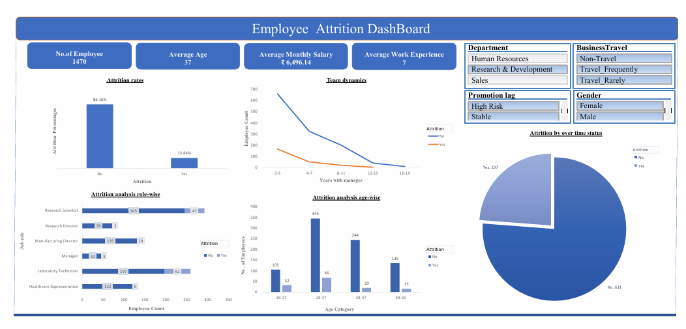

# 👥Employee Attrition Dashboard (Excel)

## 📌 Project Overview
An interactive **Microsoft Excel HR Analytics dashboard** built on the IBM HR Employee Attrition dataset to uncover the primary drivers behind employee turnover across departments, age groups, job roles, tenure, and overtime status.

## 🎯 Business Objectives
* Track key workforce metrics including **Total Employees, Active Workforce, Attrition Count, Attrition Rate, and Average Monthly Salary**.
* Identify high-risk employee segments by analyzing attrition across **Overtime Status, Age Brackets, Job Roles, and Years at Company**.
* Provide HR leadership with interactive filtering tools to support employee retention strategies.

## 🛠️ Tools & Skills Used
* **Microsoft Excel:** Pivot Tables, Pivot Charts, Dynamic Slicers (*Department, Business Travel, Promotion Lag, Gender*), and custom KPI cards.
* **Data Cleaning & Feature Engineering:** Age bracket grouping, tenure grouping, and attrition rate formulas.
* **HR & People Analytics:** Turnover risk evaluation, compensation benchmarking, and workload impact analysis.

## 📈 Key Insights
* **Overtime Impact:** Employees working **Overtime** experience a significantly higher attrition rate (~25%) compared to non-overtime staff (~10%), highlighting workload burnout as a top retention risk.
* **Age & Career Stage:** Younger employees (particularly in the 26–35 age group) and early-tenure staff show higher turnover compared to mid-to-senior career employees.
* **Role-Specific Turnover:** Sales Representatives, Laboratory Technicians, and Research Scientists exhibit distinct attrition patterns that respond dynamically to department and travel filters.

## 📂 Repository Contents
* [`Project.xlsx`](Project.xlsx) — Complete Excel workbook containing the raw dataset, Pivot Tables, and interactive dashboard.
* [`Attrition DashBoard.pdf`](Attrition%20DashBoard.pdf) — Exported PDF version of the dashboard for quick viewing.
* [`Employee-Attrition.png`](Employee-Attrition.png) — High-resolution dashboard preview.
